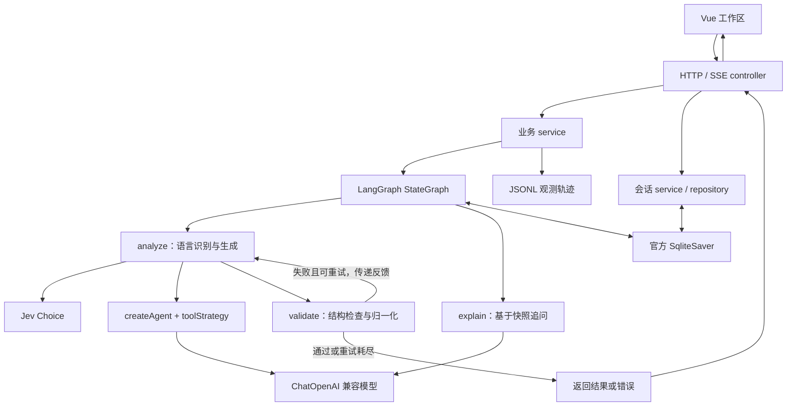

# Code2Flow 架构说明

本文描述当前代码的职责划分、数据流和实现边界，核对日期为 2026-10-22。产品范围与验收目标见 [product.md](./product.md)，开发约束见 [AGENTS.md](../AGENTS.md)，安装和启动见 [README.md](../README.md)。依赖版本和运行命令以各级 `package.json` 与根锁文件为准。

## 系统边界

Code2Flow 是面向本机单用户的代码控制流分析应用。前端使用 Vue 3、TypeScript、Vite、Monaco 和 Mermaid；后端使用 Express、LangChain 1.x、LangGraph 1.x、Zod 和官方 SQLite checkpointer。

代码分析包含两类外部调用：程序直接调用 TypeSafe Jev Choice 识别语言，再通过 ChatOpenAI 兼容接口调用生成模型。默认生成服务为 DeepSeek。源码会发送给这两类服务；追问会向生成服务发送分析源码、已有结果和历史问答。应用不执行用户代码，也没有项目扫描、跨文件解析或编译器级控制流分析。

浏览器通过 `/api` 访问后端。开发环境由 Vite 代理到 `http://localhost:3000`；生产构建只生成前端静态文件和后端产物，当前没有内置生产静态托管或部署编排。

## 目录与职责

### 后端

| 位置（相对 `backend/src/`）                                         | 职责                                                          |
| ------------------------------------------------------------------- | ------------------------------------------------------------- |
| `index.ts`、`app/`、`routes/`                                       | 加载环境、启动 Express、解析请求体和注册路由                  |
| `controllers/`                                                      | 校验 HTTP 输入、序列化 JSON / SSE、转换响应错误               |
| `services/flow-generation.service.ts`                               | 统一生成与追问入口、会话锁、检查点选择、请求级 trace 生命周期 |
| `services/session.service.ts`、`repositories/session.repository.ts` | 会话目录、草稿、历史索引与检查点详情组装                      |
| `services/usage.service.ts`                                         | 用量查询与响应契约校验                                        |
| `domain/flow/`、`domain/session/`、`domain/usage/`                  | Zod schema、推导类型及语言枚举                                |
| `ai/graph/`                                                         | 原生 StateGraph、状态通道、条件重试和 saver / 旧快照导入      |
| `ai/chains/`                                                        | 生成 Agent 与追问模型调用                                     |
| `ai/llms/openai.ts`                                                 | ChatOpenAI 模型配置                                           |
| `ai/tools/detect-language.tool.ts`、`ai/clients/jev.client.ts`      | 语言识别策略和 TypeSafe SDK 调用；不注册为 Agent Tool         |
| `prompts/`、`ai/prompts/`                                           | 通用生成、追问、语言检测和语言专用规则                        |
| `utils/`                                                            | 源码编号、Mermaid 归一化、映射检查与归一化、SSE 写入          |
| `ai/observability/`、`eval/`                                        | 框架回调、轨迹读写、离线评估与报告对比                        |

Controller 不编排模型步骤，chain 不管理业务重试；流程状态由 LangGraph 原生通道合并和持久化。

### 前端

| 位置（相对 `frontend/src/`） | 职责                                               |
| ---------------------------- | -------------------------------------------------- |
| `app/App.vue`                | 工作区 / 用量控制台切换；保持工作区实例挂载        |
| `pages/`                     | 页面组合与页面级事件连接                           |
| `features/workspace/`        | 会话列表、草稿保存、文件读取、切换与源码快照一致性 |
| `features/flow-generation/`  | SSE 事件消费、生成状态和结果恢复                   |
| `features/code-editor/`      | Monaco 文档、高亮语言和源码定位                    |
| `features/flow-diagram/`     | Mermaid 渲染、节点点击、相机与小地图               |
| `features/usage-console/`    | 用量查询状态                                       |
| `entities/`                  | 前端接口类型、语言选项、扩展名与 Monaco 映射       |
| `shared/api/`、`shared/lib/` | axios / fetch 请求和 Monaco / Mermaid 初始化       |

前后端契约分别维护，尚未生成共享契约包；变更字段或事件需要同步两端。

## 生成链路与重试

1. `POST /api/generate-flow` 接收 `code` 和可选 `thread_id`，通过 Zod 校验后建立 SSE 响应。
2. Service 对有 ID 的请求取得进程内会话锁，确保会话目录存在，创建观测采集器，并选择 saver。无 ID 的生成默认不持久化。
3. 每次新生成重置结果、检测结果、解释、错误、尝试次数和问答消息，写入本次源码。旧图和旧问答不作为本次生成输入，失败也不回退到旧结果。
4. `analyze` 首次调用 Jev 识别语言，后续生成重试复用 `languageDetection`。检测配置错误在生成调用之前抛出，不进入生成重试。
5. Chain 组合通用规则与语言专用规则，将源码标成“原始行号 | 源码内容”，通过 `createAgent` 和 `toolStrategy` 请求 `submit_code_flow_result` 结构化结果。模型只提交 `mermaid` 与 `mappings`，程序补上检测语言。
6. `validate` 检查结构与映射，归一化 Mermaid 和源码范围。生成调用异常、结构异常或校验异常写入图状态 `error`，由条件边决定重试。
7. 通过校验后返回结果；重试耗尽则抛出错误。Service 在成功或失败时完成 trace，Controller 发送最终结果或错误并关闭连接。

每次 analyze 最多进行一次生成模型调用：`modelCallLimitMiddleware` 限制为 1，`toolStrategy.handleError` 为 false，ChatOpenAI 的 SDK 重试为 0。`CODE2FLOW_MAX_RETRIES` 默认 1，允许 0–10，因此默认最多尝试生成两次。下一次尝试会收到上次错误作为修正反馈。追问不经过这条重试边。

### 语言识别

语言枚举以 `backend/src/domain/flow/language.ts` 为准，当前包含 23 种语言 / 组件格式和 `unknown`。识别候选与规则集中在 `backend/src/prompts/detect-language.prompt.ts`；前端配置在 `frontend/src/entities/flow/model/languages.ts`。

Jev 使用官方 TypeSafe SDK，设置单次超时、取消信号和零重试。返回结果必须满足 Choice schema：语言有效、概率完整、总和接近 1，且选择项为最高概率项。默认模型、超时和置信度阈值见 `backend/.env.example`。

| 情况                                                   | 行为                            |
| ------------------------------------------------------ | ------------------------------- |
| 有效识别且达到阈值                                     | 使用检测语言生成并返回 metadata |
| 低置信度或选择 unknown                                 | 保留 unknown，使用通用语言规则  |
| 超时、临时请求失败、畸形响应                           | 降级为 unknown，继续生成        |
| 缺少密钥、SDK 无法加载、无效配置、HTTP 401 / 403 / 404 | 报配置错误并结束请求            |

手动选择编辑器语言或根据文件扩展名推断的语言用于高亮与草稿；生成接口没有语言参数，不能覆盖 Jev 的检测结论。追问复用已有分析，不重新检测。

## 结果契约与校验边界

最终结果为 `{ detectedLanguage, mermaid, mappings }`。每个 mapping 包含 `nodeId`、`kind`、`label`、`description`、`lineStart`、`lineEnd`，可选 `columnStart`、`columnEnd`。节点类型为 `start / action / decision / return / end`。具体字段与跨字段约束以 `backend/src/domain/flow/schema.ts` 为准。

Prompt 要求中文职责标签、图中节点与 mappings 一一对应，ID 采用 `n_<kind>_<lineStart>`，同一行多个节点加后缀；合并同一职责下的连续语句，保留分支、循环、异常和提前返回边界。编号保留空行与注释，避免模型重新计数造成偏移。

当前程序检查与目标仍有差距：

- Zod 检查字段类型、正整数范围、起止行顺序和同一行的列号顺序。
- `validateNodeMappings` 检查 mapping ID 不重复，并以文本匹配检查其在 Mermaid 中出现；没有解析全部图节点来检查反向覆盖，也未强制检查 ID 命名和标签一致性。
- Mermaid 归一化只去除回车和首尾空白；后端校验只检查以 `flowchart TD` 开始且包含 `-->`，没有完整语法解析。通过后端校验仍可能在浏览器渲染失败。
- 行号归一化将超界值夹到源码范围，空行、部分注释或独立大括号行优先向后、再向前寻找可执行行。行号变化时删除列号；不会重新生成 nodeId。
- 可执行行判断使用文本启发式，未覆盖所有语言的注释或语法；列号也未按实际行长完整校验。因此合法范围不等于准确语义映射。

前端最终渲染失败会显示错误，但不会触发后端自动重试。模型语义、映射准确性和 Mermaid 可渲染性需要分别验证。

## HTTP 与流式协议

| 方法与路径                 | 输入 / 输出与用途                                                         |
| -------------------------- | ------------------------------------------------------------------------- |
| `GET /api/health`          | 后端存活检查                                                              |
| `POST /api/generate-flow`  | `{ code, thread_id? }` → SSE                                              |
| `POST /api/follow-up`      | `{ thread_id, question, code? }` → `{ thread_id, question, explanation }` |
| `GET /api/sessions`        | `{ sessions }`，只返回元信息与状态                                        |
| `POST /api/sessions`       | 可选 ID、标题、文件名、草稿和高亮语言 → 新会话详情，HTTP 201              |
| `GET /api/sessions/:id`    | 草稿、分析源码快照、结果、问答与失败状态                                  |
| `PATCH /api/sessions/:id`  | 更新标题、文件名、草稿或高亮语言 → 会话详情                               |
| `DELETE /api/sessions/:id` | 删除目录与检查点，HTTP 204                                                |
| `GET /api/usage`           | 观测开关、扫描限制标记与生成用量记录                                      |

生成 SSE 使用 `data: <JSON>\n\n`，事件类型放在 JSON 的 `type` 中，不使用命名 SSE event。事件契约如下：

| type       | content                             | 语义                                     |
| ---------- | ----------------------------------- | ---------------------------------------- |
| `metadata` | `{ detectedLanguage, confidence? }` | 首次检测结果；最终结果前再次确认语言     |
| `mermaid`  | 字符串                              | 当前完整图源快照，覆盖前一快照，不能拼接 |
| `mappings` | mapping 数组                        | 最终映射                                 |
| `done`     | 无                                  | 成功结束                                 |
| `error`    | 错误字符串                          | 失败结束                                 |

标准 LangChain 回调合并 `AIMessageChunk`，从部分工具参数中取得 Mermaid 并发送快照。最终成功顺序为 metadata → mermaid → mappings → done；此前可收到初始 metadata 和多次部分 mermaid。失败发送 error 并关闭连接，不发送 done。部分图未完成最终校验，不能视为已确认结果。

请求体校验失败时返回 HTTP 400 JSON；建立 SSE 后的错误通过 error 事件表达。会话管理接口区分参数错误 400、不存在 404、写冲突 409 和内部错误 500；追问 Controller 当前将服务异常统一返回 400，不能假定所有接口都以 HTTP 409 表达锁冲突。

普通请求使用 axios，生成使用 fetch 读取 SSE。生成状态为 idle / streaming / done / error，断网或流结束未收到 done 都进入 error。追问当前为普通 JSON 响应，没有追问流式协议。

## 会话、草稿与一致性

### 存储分工

| 数据                                              | 存储与真源                                                |
| ------------------------------------------------- | --------------------------------------------------------- |
| 分析源码、检测结果、流程图、映射、问答、执行状态  | LangGraph 官方 SqliteSaver 检查点                         |
| 标题、文件名、创建 / 更新时间、编辑草稿、高亮语言 | 同一 SQLite 文件内的 `code_flow_sessions` 表              |
| 删除标记                                          | `code_flow_deleted_sessions` 表，阻止旧 JSON 导入复活会话 |
| 活动会话 ID、侧栏偏好                             | 浏览器 localStorage，不作为源码或结果真源                 |
| 模型 / 节点耗时、用量与执行摘要                   | JSONL 观测文件                                            |

SQLite 默认路径是进程工作目录下 `.code2flow/checkpoints/code-flow.sqlite`，通过 `CODE2FLOW_CHECKPOINT_DB` 覆盖；从根脚本启动时后端工作目录为 `backend/`。目录和业务表按需创建，无独立迁移命令。

有 thread_id 的生成与追问通过 `configurable.thread_id` 读写检查点。无 ID 的一次性生成与默认离线评估不使用默认 saver，测试可显式注入 saver。首次访问会话列表 / 详情时，service 通过官方 `saver.list` 登记现有 SQLite 线程，以“历史分析 + 短 ID”命名，不复制检查点内容。

旧 JSON 仅在追问恢复时、SQLite 尚无该线程检查点的情况下按需导入，通过 `updateState` 写入框架状态；原文件只读。已有 SQLite 失败线程不会回退到旧 JSON。该机制不批量扫描旧 JSON 生成会话列表。

### 源码快照与切换

编辑草稿与分析源码分别存储。草稿停止编辑 700ms 后保存，切换 / 新建前先等待保存成功，再整体恢复目标会话；失败保留当前内容。上传文件在浏览器读取，前端限制为 200 KiB；草稿 schema 限制字符串长度为 200 × 1024。Express JSON 请求体上限为 2 MiB，以上限制不是生成接口统一的源码长度上限。

生成与追问期间，前端锁定编辑和会话切换，避免响应写入其他会话。新建会话和重新生成清空页面旧问答。刷新后使用浏览器保存的 ID 向后端恢复；Monaco 文档身份绑定 thread_id，切换会话重建编辑器，语言变化只更新高亮。

草稿与分析源码不同时，前端提示重新生成并停止节点定位和追问。后端追问先从检查点读取结果；问题不能为空，必须已有图。如果提供的非空 code 与快照不一致，拒绝追问。未提供 code 时直接使用检查点源码。`explain` 将源码、结果、历史消息与新问题交给模型，保存用户消息和模型回答，不重新生成图；Prompt 要求不返回内部推理过程。

### 并发与删除

同进程使用 thread_id 集合互斥生成、追问、草稿更新、创建和删除；冲突立即失败，不排队。不同会话可并行。读取不在这把写锁内，列表 / 详情带 busy 状态供前端判断。

删除先调用官方 `saver.deleteThread`，再删除目录并记录删除标记。官方检查点与业务目录操作没有被封装成一个跨步骤事务。当前锁只在单进程内有效，没有多实例协调或用户隔离。

## 图渲染与源码定位

`useMermaidRenderer` 合并高频更新，流式期间约每 450ms 调度最新快照，并串行调用 Mermaid。SVG 在屏幕外渲染与测量，版本仍有效时才替换画布；未完成片段渲染失败时保留上一张有效图，最终失败显示错误。

`useDiagramViewport` 独立管理缩放和平移，提供适应全图、原始字号阅读、手动拖动、键盘操作及小地图；FlowDiagram 提供专注视图。小地图复用已渲染 SVG 的节点和连线几何，不再次调用 Mermaid。更新时以首节点位置保留观察锚点，流结束不无条件强制适应全图。

点击已映射节点后，页面查找 mapping，调用 Monaco 滚动、选中和高亮对应源码范围，并预填一个引用该节点的追问。当前没有从源码选择反向定位图节点，也没有解释文本中的节点链接。未注册的 Monaco 语言回退为 plaintext。

## 观测与用量控制台

Service 统一完成成功 / 失败采集和 JSONL 写入；外部显式传入 trace 时由调用者负责落盘。框架模型回调记录调用轮数、响应模型和供应商 token usage，节点回调只记录 analyze / validate / explain。重试的生成用量累加，失败也保留已回报用量。

工作区通过 v-show 保持挂载，切到控制台不会终止 SSE；控制台进入和手动刷新时请求 `/api/usage`。查询读取 `CODE2FLOW_TRACE_FILE` 末尾最多 4 MiB，跳过截断、损坏、追问和明确标记为 eval 的记录，按开始时间倒序最多返回 50 条。响应经 Zod 白名单处理，不返回完整 trace、源码或原始错误。

控制台只展示生成模型 token；Jev 单独记录检测耗时、模型与用量，不计入该统计，追问也不在控制台列表中。用量完整性区分 complete / partial / missing / unknown；旧记录来源或回报情况未知时保守展示。关闭 `CODE2FLOW_TRACE` 只停止轨迹写入，历史仍可读，也不会关闭其他 console 日志。配置在进程内缓存，修改后需重启。

## 验证与运行依据

运行要求 Node.js >=22。根目录和前后端 `package.json` 是运行命令真源；配置项见 [backend/.env.example](../backend/.env.example)。架构文档不维护安装待办或某次执行结果。

后端测试位于 `backend/tests/`，涵盖图编排、重试、会话恢复 / 管理、HTTP / SSE、源码行号、观测、用量和评估。集成测试使用本地 OpenAI 兼容 HTTP / SSE 夹具，可经过 ChatOpenAI、createAgent、StateGraph、SQLite 和 Express，不依赖真实生成服务。测试类型通过 `backend/tsconfig.tests.json` 单独检查。

前端测试位于 `frontend/tests/`，目前覆盖视口几何、会话 / 用量契约及生成状态；这些测试不能替代真实浏览器中的 Monaco、Mermaid、文件上传和会话交互验证。

`backend/src/eval/` 提供基线跑批、报告对比与轨迹分析。当前基线为 JS / TS / Vue 和边界输入，指标主要是结构、映射、范围、节点类型、关键词与数量。跑批会调用模型，需要环境配置；宽松规则得分不能证明完整语义正确，也不能代表全部支持语言或长源码的准确率。

## 已知实现差距

以下是当前代码边界，未在本次文档更新中修改实现：

- Mermaid 完整解析、节点与 mapping 的双向覆盖、跨语言行号与列号准确性仍需加强，具体见结果校验章节。
- `code-flow.chain.ts` 仍通过 console 输出完整输入消息和 Agent 原始结果，与 AGENTS.md 中“日志不记录用户源码”的约束有差距；关闭 trace 不能消除这些日志。
- Mermaid 当前启用 `securityLevel: 'loose'` 和 HTML labels，通过 innerHTML 插入生成 SVG；没有独立的模型图源 / SVG 清洗层。
- 应用没有鉴权、按用户授权、限流或多实例锁；SQLite 与进程内锁对应本机单实例使用范围。
- SSE 连接关闭尚未贯穿到图执行和模型请求取消；前端检测连接失败不代表后端已停止生成。
- 当前为桌面三栏工作区，应用最小宽度 1100px，没有移动端会话抽屉或面板切换方案。
- 尚无本次核验可证明的多语言准确率、50–500 行源码质量或首图延迟指标；不能将语言枚举或旧规划视作质量承诺。
