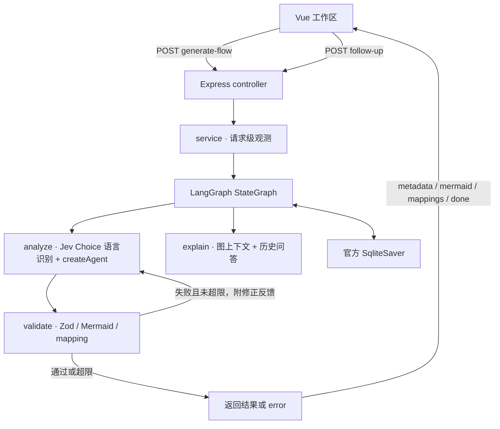

# Code2Flow Architecture

当前架构更新于 2026-10-20，已迁移到 LangChain 1.x / LangGraph 1.x 原生 API。

2026-10-21：产品范围扩展为多语言代码控制流分析。语言识别改用 TypeSafe Jev Choice，保留代码直接调用，不注册 Agent Tool。

## 总体结构

前端仍采用 Vue 3 / Monaco / Mermaid，`pages` 组织页面，`features` 提供编辑、生成、画图和追问逻辑，`entities` 定义前端契约，`shared` 提供 API 与库初始化。

后端是 Express → controller → service → 原生 StateGraph → LangChain createAgent / ChatOpenAI。所有生成请求走同一状态图，不再按 provider 维护两套驱动。



## 关键目录

```text
backend/src/
├─ app/ + routes/ + controllers/   Express 和 HTTP/SSE 协议
├─ services/                      同一执行入口、trace 生命周期
├─ domain/flow/                   Zod schema 与推导类型
├─ prompts/                       生成和追问规则真源
├─ ai/
│  ├─ llms/openai.ts              ChatOpenAI / DeepSeek 兼容端点
│  ├─ chains/code-flow.chain.ts   createAgent + toolStrategy
│  ├─ chains/explain-followup.chain.ts
│  ├─ graph/code-flow.graph.ts    三节点 StateGraph 与条件边
│  ├─ graph/code-flow.state.ts    StateSchema + MessagesValue
│  ├─ graph/checkpointer.ts       官方 SQLite saver 与旧 JSON 只读导入
│  ├─ tools/                     异步语言识别及降级策略
│  ├─ clients/jev.client.ts      官方 TypeSafe SDK，单次超时，无请求重试
│  ├─ prompts/                   语言专用规则
│  └─ observability/             标准模型/节点回调、trace 与 JSONL sink
├─ eval/                          评估与 A/B
└─ utils/                         结构、映射、Mermaid 与 SSE 工具
```

Vitest / Supertest 测试及模型服务器夹具统一位于 `backend/tests/`，与业务源码分开。业务构建只包含 src；测试通过 `tsconfig.tests.json` 独立检查类型，可按需运行。

## 生成与流式输出

`analyze` 将语言提示和上次校验错误交给 `createAgent`，通过 `toolStrategy` 要求模型提交 `submit_code_flow_result`。框架负责工具绑定、消息合并和 structuredResponse；Zod 继续校验跨字段约束。每个分析尝试只允许一次模型调用，外层图统一管理重试。

标准 LangChain 回调从合并的 AIMessageChunk 获取部分 Mermaid，避免自行维护工具索引和半截 JSON 解析器。Controller 保持原有 SSE 事件形状，部分图源仍是完整快照，最终再发送 mappings 和 done；错误发送 error。

`validate` 检查结构、节点映射和现有 Mermaid 特征规则，并归一化代码行。语言完全由 Jev 检测结果确定；生成模型仅提交 mermaid 与 mappings，由程序补齐 detectedLanguage。模型调用或结构异常也会成为图状态错误，进入同一条件边；默认重试 1 次，最多重试 10 次，可用 `CODE2FLOW_MAX_RETRIES` 配置。框架 SDK 的额外模型请求重试已关闭，以免和业务重试相乘。

## Jev 语言检测

`runDetectLanguage` 在首次 analyze 调用 Jev，将结果存入 `languageDetection`；生成失败重试时复用检测结果，同一线程新生成时清空，追问不检测。候选与规则集中于 `src/prompts/detect-language.prompt.ts`，候选键覆盖 `SupportedLanguageSchema` 的 23 种语言/组件格式及 unknown。JS/TS 共用且无 TS 特有语法的片段默认 javascript，Vue SFC 整体归 vue。

官方 SDK `@typesafe-ai/sdk@0.7.0` 使用 `POST /v1/systemone`。配置放在后端 `.env`：`TYPESAFE_API_KEY`（必须替换占位值）、`TYPESAFE_DEFAULT_MODEL`（默认 jev-1.14.0）、`CODE2FLOW_LANGUAGE_TIMEOUT_MS`（默认 5000）、`CODE2FLOW_LANGUAGE_MIN_CONFIDENCE`（初始 0.6，需真实样本校准）。原有 DeepSeek 配置仍用于流程图生成。

Choice 响应经 Zod 校验语言、confidence 和完整概率分布。低置信度、unknown、超时、临时网络/服务故障、畸形响应使用通用语言提示继续生成；缺少密钥、无效配置、401/403/404 报配置错误。Jev 不进行自动重试，超时取消请求。检测耗时、模型和用量单独输出日志，不混入原有生成模型 token 统计，不记录源码或密钥。

初始 SSE metadata 携带检测语言及置信度；最终 metadata 与生成结果均使用同一检测语言。检测结果为 unknown 时保留 unknown，生成模型按通用控制流分析，不补判语言。前端语言选项、文件扩展名与 Monaco ID 集中于 `entities/flow/model/languages.ts`，未注册的高亮语言回退 plaintext。

首次安装依赖后更新根锁文件：`npm install`。本次仅声明 SDK 依赖，未运行包管理命令、未修改锁文件。填好密钥后运行 `npm run check` 和 `npm --prefix backend run typecheck:tests`，再进行真实 Jev 联调。无数据库迁移。

官方依据：[Choice](https://docs.typesafe.ai/primitives/choice)、[JavaScript SDK](https://docs.typesafe.ai/sdk/javascript)、[请求取消与超时](https://docs.typesafe.ai/sdk/javascript/api/interfaces/RequestOptions)、[置信度](https://docs.typesafe.ai/confidence)。置信度不是分类准确率，新增语言的识别与流程图质量需要分别评估。

Mermaid 校验仍沿用当前轻量规则，尚非完整语法解析；本次没有声称提高模型的控制流语义准确率。

## 会话与持久化

原生 `.compile({checkpointer})` 按 `configurable.thread_id` 持久化状态。默认 SQLite 文件为后端工作目录下 `.code2flow/checkpoints/code-flow.sqlite`，可用 `CODE2FLOW_CHECKPOINT_DB` 覆盖，无需 Docker 或额外数据库服务。

未提供 thread_id 的一次性生成和评估不使用默认持久化检查点；测试或调用者仍可显式注入 saver。

生成时清空旧 result、explanation 和问答消息；失败也不恢复旧图。追问从原生 checkpoint 恢复源码和结果，并将问答追加到 MessagesValue。若请求带入的新源码与生成快照不同，明确拒绝并要求重新生成，防止新代码搭配旧图。

仅当 SQLite 中没有线程时，按需读取旧 `CODE2FLOW_CHECKPOINT_FILE` 的 `generate:<threadId>` 记录并通过 `updateState` 导入；原 JSON 保持只读。已有 SQLite 线程的失败结果不会从旧 JSON 复活。

SQLite 当前用于单机或单实例持久化；没有实现同线程并发请求调度、浏览器历史会话列表或检查点清理策略。

## 观测、测试与运行

### Usage 控制台

顶部「工作区 / 控制台」通过本地页面状态切换，工作区保持挂载，因此源码、流程图、问答和生成中的 SSE 不因切换丢失。控制台进入时及手动刷新时，通过 axios 请求 `GET /api/usage`。

查询链路为 usage controller → usage service → JSONL reader，复用 `CODE2FLOW_TRACE_FILE`，不新增数据库。只扫描日志末尾 4 MiB，跳过截断、损坏、追问和明确标记为评估的记录，按开始时间倒序返回最多 50 条；较早日志超出扫描范围时页面提示。响应通过 Zod 白名单契约，不返回源码、原始错误或完整 trace。该接口与现有应用一样是单机使用范围，未增加用户鉴权或按用户隔离，公开部署前需要整体访问控制。

新 trace 标记 online / eval 来源，并记录供应商响应模型名和有效 usage 回报轮数。一次生成内所有重试用量累加；失败仍保留已返回的用量，缺失或部分回报有明确标记。历史记录保留兼容，模型配置只称为请求模型，完整性和来源未知时明确展示。控制台只统计 DeepSeek 生成 token，不含 Jev、追问或金额估算；关闭观测后保留历史可读并提示新请求不再记录。原 SSE 契约保持不变。

service 收口成功/失败和采集器落盘；标准模型回调覆盖生成与追问的轮次和供应商 Token 用量，标准节点回调只记录 analyze / validate / explain。原评估与 A/B 模块继续使用相同 service 和 trace 契约。

Node.js 要求 >=22。根目录 `npm run dev` 同时启动双端，`npm run build` 构建双端，`npm run test:backend` 执行后端测试。集成测试使用本地 OpenAI 兼容 HTTP/SSE 服务，实际经过 ChatOpenAI、createAgent、StateGraph、SQLite、Express，不需要真实模型密钥。
