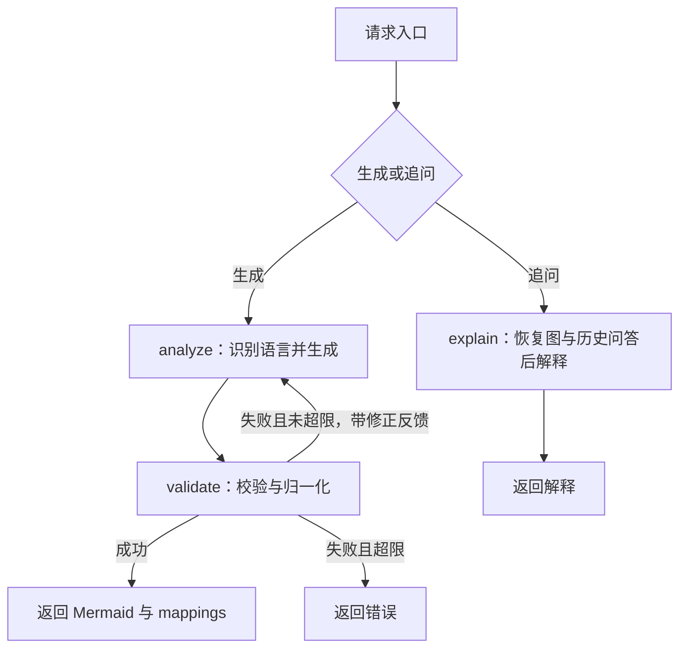

# LangChain / LangGraph 原生重构报告

日期：2026-10-20。目标：升级当前稳定版本，用框架原生能力替换手写工具循环、状态驱动和检查点实现，降低理解和维护成本，同时保留生成、SSE、节点映射、追问、观测及评估链路。

> 后续目录整理：本文记录框架重构完成时的验证快照。测试现已统一迁至 `backend/tests/`，原文测试路径对应迁移前位置；迁移仅调整导入，未重新执行测试。统计脚本已同时纳入 src 与 tests，避免将移动测试误计为代码删减。

## 1. 结果与统计

后端现已实际使用 LangChain `createAgent` 和 LangGraph `StateGraph`，生成与追问统一走同一张原生图。旧 provider 分发、手写 while 驱动、工具消息循环、自定义文件 checkpointer 和半截 JSON 扫描器均已移除。

行数以本次开始时的**当前工作区**为基线，包含原有未提交的 observability / eval 代码；不使用落后的 HEAD 代替后端基线。统计物理行，包含注释和空行，排除依赖、构建产物、自动生成 JS、锁文件和文档；新增测试夹具计入测试，已执行 Prettier，未通过压缩排版减少行数。

| 范围                                   | 重构前 | 重构后 | 变化 | 减少比例 |
| -------------------------------------- | -----: | -----: | ---: | -------: |
| 后端业务源码                           |  3,456 |  2,565 | −891 |   25.78% |
| AI、编排与生成服务业务代码（上行子集） |  1,868 |    982 | −886 |   47.43% |
| 后端测试与夹具                         |    667 |    743 |  +76 | 测试增加 |
| 后端全部 TypeScript                    |  4,123 |  3,308 | −815 |   19.77% |
| 前端 TS / Vue / CSS                    |  2,204 |  2,205 |   +1 | 类型修正 |
| 前后端全部源码                         |  6,327 |  5,513 | −814 |   12.87% |

后端 TS 文件由 59 个减少到 45 个。测试由原 30 项增加到 37 项，核心集成测试实际经过框架与 HTTP 链路，未以删除测试来换取业务行数下降。

完整逐文件记录：[baseline.json](./baseline.json)、[line-counts.json](./line-counts.json)。重新统计：在项目根目录执行 `node docs/langchain-langgraph-refactor/measure-lines.cjs`。前端重构开始时无未提交修改，其基线取自当时 HEAD；后端使用已保存的工作区逐文件行数及 SHA-256。

## 2. 依赖升级

版本在实施时读取 npm 官方 registry 的 `latest` 标签，并以精确版本写入 manifest / lock；没有使用 beta / rc，也没有仅修改版本号而保留旧安装。

| 依赖                                     | 原锁定版本 | 当前锁定版本 |
| ---------------------------------------- | ---------- | ------------ |
| `langchain`                              | 未安装     | 1.5.18       |
| `@langchain/core`                        | 0.3.80     | 1.2.18       |
| `@langchain/langgraph`                   | 0.4.9      | 1.5.1        |
| `@langchain/openai`                      | 0.6.17     | 1.6.2        |
| `@langchain/langgraph-checkpoint-sqlite` | 未安装     | 1.1.0        |
| `zod`                                    | 3.25.76    | 4.6.7        |

Zod 升级用于原生 StateSchema 所需的 schema/JSON Schema 接口；业务结果仍由同一领域 schema 定义并校验。`npm ls --workspace backend ...` 已确认后端 LangChain 各包共用 core 1.2.18，无失效 peer dependency。

后端明确要求 Node.js >=22，适配当前 OpenAI 集成的运行要求。本机 Node 22.19.0 已成功加载 SQLite 原生模块并完成测试。

实现依据：[LangChain 结构化输出](https://docs.langchain.com/oss/javascript/langchain/structured-output)、[LangGraph 持久化](https://docs.langchain.com/oss/javascript/langgraph/persistence)。当前用 toolStrategy 兼容 DeepSeek 的工具调用接口，并将 thread_id 交给官方 checkpointer。

## 3. 实现如何变得更清楚

### 3.1 生成 chain：308 行 → 43 行

`ai/chains/code-flow.chain.ts` 现在只做几件事：提供模型、系统规则、输入代码、上次失败反馈与结果 schema，调用 createAgent，然后用 Zod 检查 structuredResponse。

框架接管 tool binding、工具调用消息往返、结果工具识别和结构化参数提取。语言由程序在 analyze 前半段识别，再直接传给模型，不再要求模型额外调用语言工具。删除重复的 generate / stream 包装和手写 4 轮工具循环。

每个分析尝试限制 1 次模型调用；外层图负责总重试次数，避免框架与业务层各自重试导致次数相乘。

### 3.2 原生状态图替换手写驱动

`ai/graph/code-flow.graph.ts` 显式定义三个节点：



框架真实编译出的图见 [state-graph.mmd](./state-graph.mmd)，由 `createCodeFlowGraph().getGraphAsync().drawMermaid()` 导出，非手工假定拓扑。

原先的 detect / normalize / retry 等单独转发节点及路由文件合并进三个有业务意义的节点和条件边。状态更新由框架通道合并，不再每步手动展开整个 state，不再调用自定义 restore/save 方法。

### 3.3 状态定义：72 行 → 20 行

`StateSchema` 定义结果、错误、尝试次数等状态，`MessagesValue` 负责问答消息合并。删除自定义初始状态构造、快照提取和快照覆盖恢复函数。

生成前显式清空旧图与旧问答；追问仅传本轮问题，由框架恢复已存在状态。

### 3.4 原生 SQLite 检查点

`ai/graph/checkpointer.ts` 只负责延迟打开官方 SqliteSaver，以及读取旧 JSON 的兼容导入，不再维护文件 cache、串行写队列和自定义 checkpointer 协议。延迟初始化同时避免在 dotenv 加载前固定文件路径。

SQLite 文件默认位于后端工作目录下 `.code2flow/checkpoints/code-flow.sqlite`，可用 `CODE2FLOW_CHECKPOINT_DB` 指定。SQLite 是本地嵌入式文件，无需 Docker 或独立数据库服务。

带 thread_id 的请求使用持久化；不带 thread_id 的一次性生成和评估不进入默认持久检查点，保留原有运行边界。

旧 JSON 的 `generate:<threadId>` 记录只在 SQLite 尚无该线程时按需导入，原 JSON 不被覆盖；已有线程生成失败后，不会从旧 JSON 恢复过期结果。

### 3.5 流式输出与观测合并

旧 `toolCallResultStreamer.ts` 的手写转义/字符串扫描和工具索引拼接已移除，改为 LangChain `AIMessageChunk.concat` 提供的部分工具参数。标准回调输出完整行快照，HTTP 事件形状保持一致。

模型回调同时记录生成和追问的模型调用数、供应商 Token 用量；节点回调记录 analyze / validate / explain，避免把框架内部细节全部写入业务轨迹。原 trace collector、sink、评估器和 A/B 对比能力保留。

### 3.6 Service：130 行 → 54 行

生成、流式生成、追问共用 runFlow。默认 saver、采集器生命周期、错误记录与最终落盘集中一处；外部注入的采集器仍由评估调用者落盘。原 Agent provider facade 删除，避免两条实现继续分叉。

## 4. 同时解决的行为问题

| 原问题                                     | 重构后行为                                                |
| ------------------------------------------ | --------------------------------------------------------- |
| analyze 中的 schema/模型异常直接跳过重试   | 错误写入状态，经 validate 条件边统一重试                  |
| 下一次生成不知道上次错在哪里               | 上次错误作为修正反馈提交模型                              |
| 环境重试配置仅进入 trace，未真正改变 graph | 实际运行与配置指纹共用 resolveRunConfig；允许 0–10 次重试 |
| graph 已识别语言，chain 仍要求语言工具往返 | 只执行本地识别，直接将语言上下文交给模型                  |
| 默认 provider 不支持追问，但前端仍显示追问 | 统一使用原生图，生成与追问能力一致                        |
| 追问只拿到最后一张图，没有聊天消息         | 当前图的历史问答通过 MessagesValue 持久化并传给模型       |
| 新代码与旧图混合解释                       | 源码与生成快照不一致时拒绝追问，要求重新生成              |
| 失败后可能留下旧图                         | 新生成先清空结果；失败不会恢复旧分析                      |
| 追问成本没有记录                           | 生成与追问都使用相同模型观测回调                          |

API 请求/响应字段、SSE `metadata / mermaid / mappings / done / error`、最终映射与前端节点定位协议保持兼容。问答的返回仍是普通 JSON。

## 5. 前端构建修正

完整构建暴露了三个现有工程问题，进行了必要修正：

- `FlowDiagram.vue` 的 prop 原只声明 nodeId，却传给要求完整 mapping 的 renderer；现在直接复用已有 NodeMapping 类型，仅增加一行类型 import。
- Mermaid 的公开类型引用 type-fest，而项目缺少该类型依赖；前端新增锁定的 type-fest 开发依赖。
- `vue-tsc -b` 会向 src 输出 JS/Vue 编译镜像，随后被 ESLint 当成业务代码检查；`tsconfig.app.json` 设置 noEmit，仅做类型检查，产物仍由 Vite 构建。已清理本次构建生成的 18 个未跟踪 JS 镜像，未删除业务源码。

构建产生的已跟踪 vite.config.js、tsbuildinfo 变动已恢复到本次开始时状态；没有借机调整界面、路由、交互逻辑或全仓样式。

## 6. 验证结果

机器可读汇总见 [verification.json](./verification.json)。

| 验证                | 结果                                                                                              |
| ------------------- | ------------------------------------------------------------------------------------------------- |
| 后端测试            | 4 个测试文件，37 项通过，见 [tests.json](./tests.json)                                            |
| `npm run build`     | 前后端完整构建成功，见 [build.log](./build.log)；Vite 仍有大包体积提示                            |
| `npm run typecheck` | 前后端类型检查通过，见 [typecheck.log](./typecheck.log)                                           |
| `npm run lint`      | 0 error，前端保留 57 个原有 Vue 模板格式 warning，见 [lint.log](./lint.log)                       |
| 编译后生产入口      | 实际启动 dist/index.js，GET /api/health 返回 200 / ok=true；探测后已停止该进程                    |
| 依赖树              | 框架实际安装版本及 peer dependency 检查通过                                                       |
| 旧引用与变更检查    | 业务源码没有旧 Agent、节点路由、自定义 checkpointer 或半截 JSON 扫描器引用；git diff --check 通过 |

测试使用本地 OpenAI 兼容 HTTP/SSE 服务，实际经过 ChatOpenAI、LangChain createAgent、原生 StateGraph、SQLite 和 Express，不靠把内部框架函数全部 mock 掉来验证。覆盖结构化生成、部分图预览、元信息、跨字段约束、错误反馈、模型失败、重试上限、映射归一化、SSE 完成/失败、会话隔离、源码变化、多轮问答、重启恢复、旧 JSON 只读导入、旧图失效、一次性运行不落检查点及实际 JSONL 成功/失败轨迹。

没有使用真实 DeepSeek 密钥调用供应商，没有执行付费语义质量跑批；本地兼容端点验证不能替代真实供应商的输出质量验收。当前前端没有自动化测试文件，因此未宣称根目录 npm run check 全链通过。

依赖审计原始结果见 [dependency-audit.json](./dependency-audit.json)。它覆盖整个工作区的生产依赖，仍列出前端/HTTP 等其他依赖告警；本次没有执行越出框架升级范围的全仓自动 audit fix。

## 7. 配置、兼容与后续运行

本地依赖已完成安装，可在根目录执行：

```powershell
npm run dev
```

其他机器先使用 Node >=22，再在根目录运行 `npm ci`，保留/创建 `backend/.env` 并配置原有 `DEEPSEEK_API_KEY`。模型仍默认 deepseek-chat 和 DeepSeek 兼容端点，密钥名称没有变化。

```env
CODE2FLOW_CHECKPOINT_DB=.code2flow/checkpoints/code-flow.sqlite
CODE2FLOW_MAX_RETRIES=1
```

旧 `CODE2FLOW_AGENT_PROVIDER` 已不再控制执行分流，可移除，也可暂时留在既有 .env 中；本次未修改本地密钥文件。`CODE2FLOW_CHECKPOINT_FILE` 仅保留为旧 JSON 导入来源，不再持续写入。

无需手动 SQL、数据库迁移命令、Docker 或前端 API 地址调整。部署时需给 SQLite 所在目录写权限和持久化磁盘；SQLite 当前适合单机/单实例，同线程并发调度、检查点清理、浏览器历史会话恢复 UI 尚未扩展。

Mermaid 完整语法解析、语义正确率、前端网络异常状态处理仍是此前已有的独立改进项；本次保留原 Mermaid 轻量检查和行号修正策略，没有把框架迁移宣称成语义验证算法升级。

## 8. 本次新增技术内容

新增实际使用的 createAgent / toolStrategy / 模型调用限制 middleware、原生 StateGraph 条件边、StateSchema / MessagesValue、官方 SQLite checkpoint、统一标准模型/节点回调，以及经过真实适配器的本地 HTTP/SSE 集成测试。

继续复用 Vue、Monaco、Mermaid、Express、领域 schema、SSE 外部协议、本地语言评分、映射归一化及原有观测/评估模块。没有新增外部数据库服务、鉴权系统、前端状态框架或部署平台。
