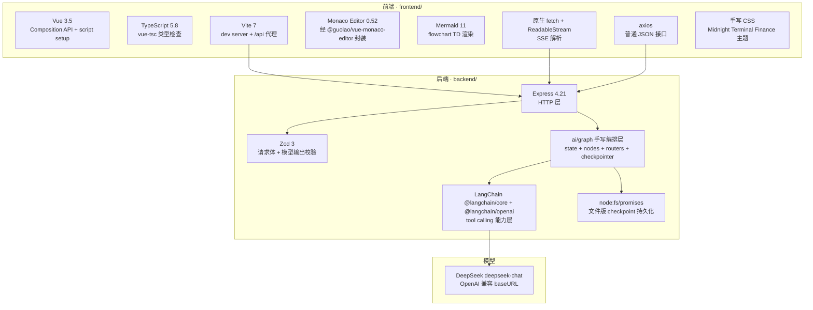
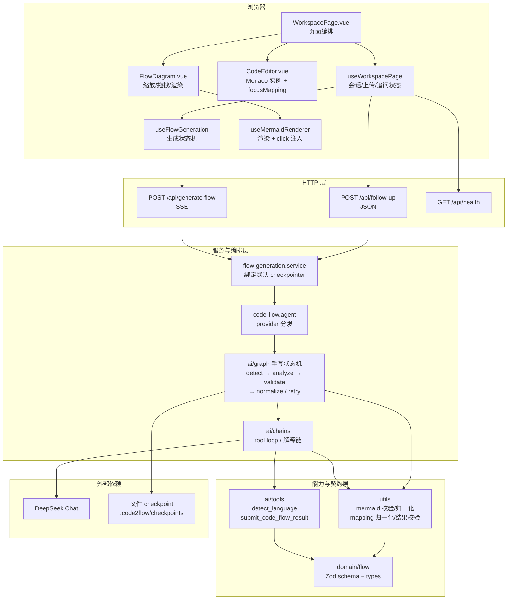
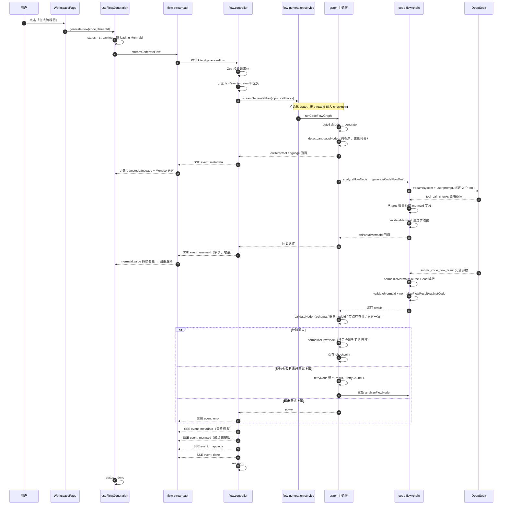
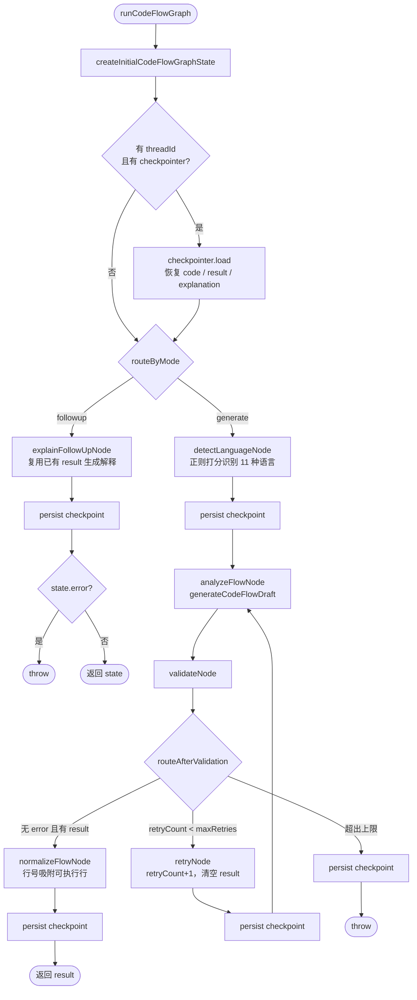
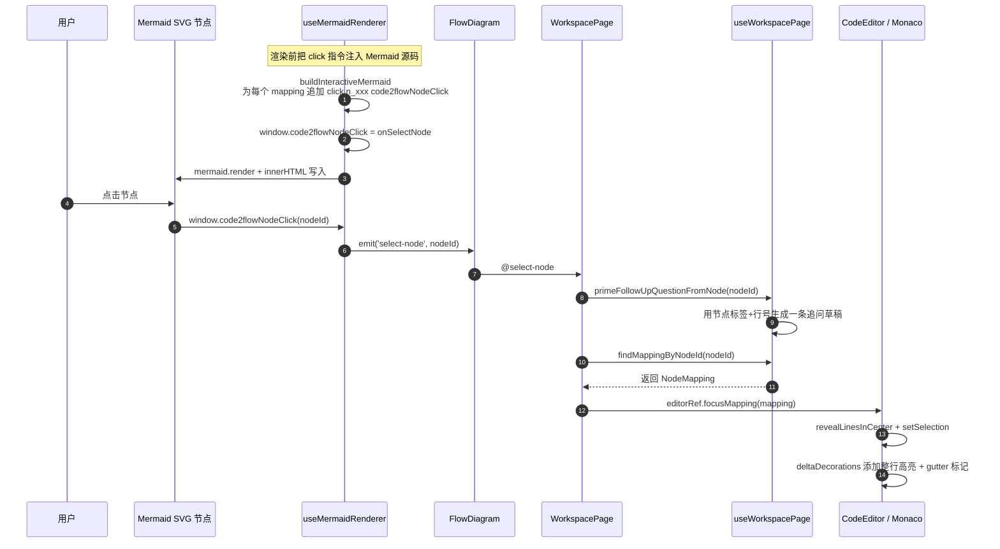
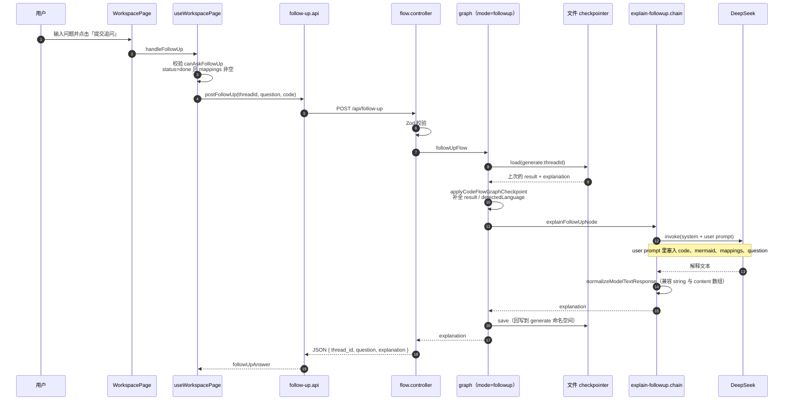
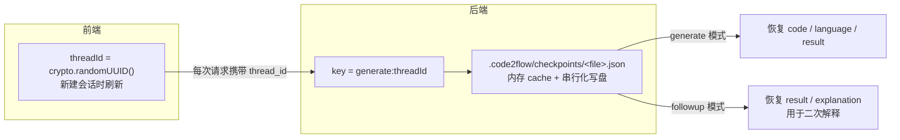
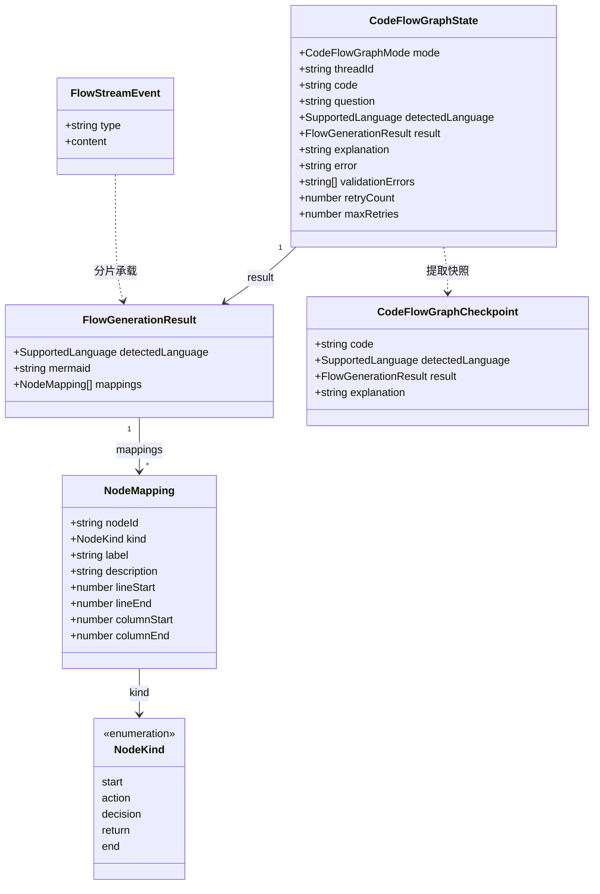

# Code2Flow 项目分析报告

> 分析对象：`D:\VS-code\code2flow`（master 分支，最新提交 `b8dc663`）
> 代码规模：后端 43 个 TS 文件 / 2118 行；前端 19 个文件 / 2204 行（其中 `styles.css` 885 行手写样式）
> 报告定位：描述"现在真实是什么样"，不替代 `docs/阶段一.md`、`docs/阶段二.md` 的目标描述

---

## 0. 一句话结论

Code2Flow 是一个**双端单体 Agent 应用**：Vue 3 单页应用负责"代码输入 + 流程图渲染 + 节点点击联动"，Express 后端负责"语言识别 → LLM 工具调用生成 → 校验 → 重试 → 行号归一化 → SSE 流式回传"。后端的编排层（`ai/graph/`）**是按 LangGraph 的形态手写的状态机**（节点函数 + 路由函数 + 状态对象 + checkpointer 接口），并未调用 `@langchain/langgraph` 的 `StateGraph` API。真正跑在模型上的能力层是 LangChain 的 tool calling（`detect_language` + `submit_code_flow_result`），模型侧接的是 DeepSeek 的 OpenAI 兼容接口。

---

## 1. 项目定位

| 维度     | 内容                                                                                              |
| -------- | ------------------------------------------------------------------------------------------------- |
| 目标     | 把 JavaScript / TypeScript / Vue 代码转成 Mermaid 流程图，并建立"图节点 → 代码行"的双向可追溯关系 |
| 目标用户 | 前端开发者、Code Reviewer、接手老项目的开发者                                                     |
| 核心闭环 | 输入代码 → 生成流程图 → 点击节点 → 编辑器高亮对应代码行                                           |
| 阶段一   | 代码输入、Mermaid 生成、节点映射、点击联动、SSE 流式                                              |
| 阶段二   | 追问解释、会话 checkpoint、更强的 Vue 语义识别                                                    |

产品形态上，它是一个**强约束、强结构化、可验证**的任务，而不是开放式自由 Agent——`docs/langgraph-plan.md` 明确写了这一点，代码实现也遵循了这个判断。

---

## 2. 技术栈

### 2.1 分层技术栈图



### 2.2 依赖启用情况核对

这一节是把 `package.json` 和实际源码逐条对照后的结果，**有三处声明了但没真正启用**：

| 依赖                                | 声明位置 | 实际状态                                                                                                                                                                                                             |
| ----------------------------------- | -------- | -------------------------------------------------------------------------------------------------------------------------------------------------------------------------------------------------------------------- |
| `@langchain/langgraph`              | backend  | **未使用**。`backend/src` 中零处 import。编排是手写的 while 循环 + 节点函数（见 `ai/graph/code-flow.graph.ts:89`），checkpointer 接口也是自定义的 `CodeFlowGraphCheckpointer`，不是 LangGraph 的 BaseCheckpointSaver |
| `tailwindcss` + `@tailwindcss/vite` | frontend | **未启用**。`vite.config.ts` 没注册 Tailwind 插件，`styles.css` 也没有 `@import "tailwindcss"`，样式全部是 885 行手写 CSS                                                                                            |
| `cors`                              | backend  | **未使用**。`createApp.ts` 只有 `express.json()`，没有 `app.use(cors())`。开发期靠 Vite 代理绕过同源问题，一旦前后端分域部署就会 404/CORS 报错                                                                       |
| `supertest`                         | backend  | **未使用**。没有任何接口级测试                                                                                                                                                                                       |
| `vitest`                            | frontend | **已配置但零测试文件**，`npm run test:frontend` 实际是空跑                                                                                                                                                           |

另外两处需要注意的版本搭配：

- `express` 是 `^4.21.2`，但 `@types/express` 是 `^5.0.0`，类型定义对应 Express 5，和运行时不是同一代。
- `frontend/vite.config.js` 和 `frontend/vite.config.ts` **内容完全重复**。Vite 的配置解析顺序里 `.js` 优先于 `.ts`，所以当前生效的是 `.js`——改 `.ts` 不会生效。两份文件目前内容一致，暂时没有行为差异，但是个明确的维护陷阱。

---

## 3. 目录结构

```text
code2flow/
├── AGENTS.md                     # 协作规则（事实上的工程约束文档）
├── DESIGN.md                     # UI 设计规范（配色/字体/布局/动效）
├── README.md
├── package.json                  # npm workspaces 根，统一 dev/build/lint/test/typecheck 入口
├── eslint.config.mjs / prettier.config.mjs
├── .husky/pre-commit             # lint-staged：prettier + eslint --fix
│
├── docs/
│   ├── 阶段一.md                  # MVP 范围与验收标准
│   ├── 阶段二.md                  # 追问/会话/解释能力规划
│   ├── prompt-spec.md            # Prompt 与输出契约（含 2 个 few-shot 示例）
│   ├── architecture.md           # 架构说明（部分内容已滞后于代码）
│   ├── langgraph-plan.md         # 编排层迁移路线与阶段状态
│   ├── scripts-plan.md           # 脚本策略
│   └── 项目分析报告.md            # ← 本文件
│
├── backend/
│   ├── .env / .env.example       # provider 开关、DeepSeek 配置、checkpoint 路径
│   ├── .code2flow/checkpoints/   # 文件版会话快照（已被 git 跟踪，见 §9）
│   └── src/
│       ├── index.ts              # 入口：dotenv + listen
│       ├── app/createApp.ts      # Express 装配
│       ├── routes/               # health.route / flow.route / index
│       ├── controllers/          # flow.controller（SSE 写事件）/ health.controller
│       ├── services/             # flow-generation.service：组装 agent + 默认 checkpointer
│       ├── agents/code-flow.agent.ts   # provider 分发：langchain | graph
│       ├── domain/flow/          # schema.ts(Zod) / types.ts / language.ts —— 契约层
│       ├── prompts/code-flow.prompt.ts # ★ 唯一的 Prompt 规则真源
│       ├── utils/                # sse / mermaidValidator / mermaidNormalizer
│       │                         # / flowResultValidator / mappingNormalizer
│       │                         # / toolCallResultStreamer
│       └── ai/
│           ├── llms/openai.ts           # ChatOpenAI 指向 DeepSeek
│           ├── prompts/                 # system / user / language 三段 prompt 组装
│           ├── tools/                   # detect_language / submit_code_flow_result
│           ├── chains/                  # code-flow.chain（tool loop + partial 流）
│           │                            # explain-followup.chain（纯文本解释）
│           └── graph/                   # ★ 编排层
│               ├── code-flow.graph.ts   # 手写状态机主循环
│               ├── code-flow.state.ts   # State / Checkpoint 定义与转换
│               ├── code-flow.types.ts   # Input / Callbacks / Checkpointer 接口
│               ├── nodes/               # detect-language / analyze-flow / validate
│               │                        # / normalize-flow / retry / explain-followup
│               ├── routers/code-flow.router.ts   # routeByMode / routeAfterValidation
│               └── checkpointers/       # file / in-memory / checkpoint-key
│
└── frontend/
    ├── index.html / vite.config.{ts,js}
    └── src/
        ├── main.ts               # 挂载 + monaco worker 注册 + 全局样式
        ├── app/App.vue           # 仅渲染 WorkspacePage
        ├── pages/workspace/WorkspacePage.vue   # 页面编排（Hero + 编辑器 + 图 + 追问）
        ├── entities/flow/model/types.ts        # 与后端重复定义的前端契约
        ├── features/
        │   ├── code-editor/      # CodeEditor.vue + CodeEditorExpose
        │   ├── flow-diagram/     # FlowDiagram.vue + useMermaidRenderer
        │   │                     # + buildInteractiveMermaid
        │   ├── flow-generation/  # useFlowGeneration（SSE 事件 → 响应式状态）
        │   └── workspace/        # useWorkspacePage（页面级编排）+ sampleCode
        └── shared/
            ├── api/              # http(axios) / flow-stream(fetch SSE)
            │                     # / follow-up / system
            └── lib/              # monaco/setup、mermaid/setup
```

**结构评价**：前端采用了简化的 Feature-Sliced Design（`app / pages / features / entities / shared`），职责边界清晰，`useWorkspacePage` 作为页面级 composable 聚合所有状态，`WorkspacePage.vue` 只做编排和事件转发——这部分是干净的。后端的 `domain / prompts / utils / ai` 分层也符合 `AGENTS.md` 的约束（Prompt 集中在 `prompts/code-flow.prompt.ts`，契约集中在 `domain/flow/`）。

---

## 4. 架构总览



**关键分层特征**：

1. **前后端之间只有 HTTP，没有共享类型包**。契约在三处各写一遍：后端 Zod schema、后端推导出的 TS 类型、前端手写的 `entities/flow/model/types.ts`。
2. **能力层与编排层解耦**。`ai/chains` 是可复用的"底层能力"（模型调用、tool loop、partial 流），`ai/graph` 只负责状态流转；`analyze-flow.node.ts` 直接调用 `generateCodeFlowDraft` 而不是整个 chain 入口，这正是 `docs/langgraph-plan.md` 第二阶段的目标，已落地。
3. **provider 双通道**。`CODE2FLOW_AGENT_PROVIDER` 可在 `langchain`（直连 chain）和 `graph`（走编排）之间切换；当前 `.env` 设为 `graph`，代码里的默认值是 `langchain`。

---

## 5. 功能链路

### 5.1 链路一：代码 → Mermaid 流程图（SSE 流式）

这是主干链路，也是全项目最长的一条。



链路上三个值得注意的实现细节：

- **增量 Mermaid 是从 tool 参数的原始 JSON 字符串里"抠"出来的**（`utils/toolCallResultStreamer.ts`）。它手写了一个 JSON 字符串字段扫描器，处理 `\n` / `\"` 等转义，并且**丢弃最后一行未闭合的内容**，再用 `validateMermaid` 卡一道才推送。这是"边生成边渲染"体验的关键，也是后端最"手写"的一段代码。
- **语言识别做了两次**。graph 节点先用正则打分确定性识别一次；随后 chain 里的 Prompt 又强制模型调用 `detect_language` 工具（`code-flow.user.prompt.ts:5`），模型调用后仍由同一个 `runDetectLanguage` 执行。第二次是冗余的一次工具轮次。
- **重试上限实际是 1**（`code-flow.state.ts:42` 的 `maxRetries ?? 1`），即最多尝试 2 次；`docs/阶段一.md` 里写的是"最多 3 次"。

### 5.2 后端编排状态机（`ai/graph`）



**校验节点查四件事**（`nodes/validate.node.ts`）：

1. `parseFlowGenerationResult` → Zod schema 是否合法
2. 同一个 mermaid 里 `nodeId` 是否重复、每个 mapping 的 `nodeId` 是否真的出现在 Mermaid 源码中
3. `validateMermaid` 是否通过
4. `result.detectedLanguage` 是否与 graph 自己识别的语言一致（防止模型"语言漂移"）

**归一化节点**（`utils/mappingNormalizer.ts`）解决的是"模型把行号指向注释/空行/孤立大括号"的问题：向上或向下寻找最近的可执行行，找到后如果行号变了就丢弃 `columnStart/columnEnd`（因为列号已失效）。这是 Prompt 约束之外的**第二道防线**，设计得比较务实。

### 5.3 链路二：节点点击 → 编辑器高亮



两个设计取舍：

- **点击回调走 `window` 全局函数**，而不是 Vue 事件。这是 Mermaid `click` 指令的既定调用方式（因此 `securityLevel` 必须为 `loose`），代价是全局命名空间被占用。
- **点节点会顺手改写追问输入框的内容**（`useWorkspacePage.ts:222`）。这是个刻意的联动设计，但如果用户已经手打了半个问题，会被覆盖掉。

### 5.4 链路三：追问解释



**checkpoint 的命名空间设计**：`buildCheckpointKey` 会把 `followup` 模式映射到 `generate` 命名空间（`checkpoint-key.ts:5`），所以追问天然能读到生成阶段沉淀的上下文，不需要额外打通。这个"两种模式共用生成态命名空间"的约定是隐式的，读代码时容易忽略。

**一个潜在的不一致**：`applyCodeFlowGraphCheckpoint` 只在当前请求的 `code` 为空时才用 checkpoint 里的 code 补全，但 `result` 是**无条件**从 checkpoint 取的。前端追问时会把编辑器里的当前代码一起发过去——所以如果用户在生成后修改了代码再追问，解释链会拿到"新代码 + 旧流程图"，两者对不上。目前没有任何校验拦住这种情况。

### 5.5 链路四：会话与 checkpoint



checkpoint 快照只保存四个字段：`code`、`detectedLanguage`、`result`、`explanation`。文件实现用**进程内 cache + `pendingWrite` 串行化**避免并发覆盖（`file-code-flow.checkpointer.ts:30`），单机单实例够用，多实例部署会丢数据——`docs/langgraph-plan.md` 也承认了这一点。

---

## 6. 数据契约



### SSE 事件契约

| type       | content                             | 触发时机                                 | 次数   |
| ---------- | ----------------------------------- | ---------------------------------------- | ------ |
| `metadata` | `{ detectedLanguage, confidence? }` | 语言识别完成时；结束前再发一次最终语言   | 1–2 次 |
| `mermaid`  | `string`                            | 分析过程中增量透出；结束后再发一次完整版 | 0–N 次 |
| `mappings` | `NodeMapping[]`                     | 全部校验与归一化完成后                   | 1 次   |
| `done`     | 无                                  | 正常结束                                 | 1 次   |
| `error`    | `string`                            | 任何阶段抛错                             | 0–1 次 |

传输格式是最朴素的 `data: {json}\n\n`，**没有 `event:` 字段、没有事件 id、没有心跳、没有 `X-Accel-Buffering: no`**。前端按 `\n\n` 切块、取 `data: ` 开头的行解析（`flow-stream.api.ts:44`）。在 Vite 代理下工作正常；放到 Nginx 等反代后面时，缺 `X-Accel-Buffering` 可能导致缓冲住不流式。

### 节点 ID 规则

`n_<kind>_<lineStart>`，同行多节点时补后缀（例如 `n_action_10_1`）。这条规则由 Prompt 约定（`code-flow.prompt.ts:37`），后端只校验"mapping 的 nodeId 必须出现在 mermaid 源码中"和"不能重复"，**没有强制校验格式**。前端依赖这个 ID 做点击映射，所以稳定性实际上靠 Prompt 约束 + 校验兜底，而不是类型系统。

---

## 7. 关键设计解读

**1. 为什么校验和归一化要放在后端，而不是只靠 Prompt？**
Prompt 里已经写了"行号不能落在注释、空行、孤立大括号上"（`code-flow.prompt.ts:43`），但模型不保证遵守。后端用 `validateNode` + `normalizeFlowNode` 做了确定性兜底：结构性错误（schema/重复 ID/节点缺失/语言漂移）触发重试，位置性偏差（行号落在非执行行）则直接静默修正。这个分工是合理的——**可判定对错的问题重试，可修正的偏差就地修**。

**2. 为什么流式 Mermaid 要经过校验才推送？**
增量透出的内容如果语法不合法，Mermaid 会渲染失败并抛出，前端会闪错误。所以 `streamToolCallingRound` 在推送前跑一次 `validateMermaid`，并且跳过最后一行未闭合的内容。代价是首帧延迟略高，收益是渲染过程不抖动。

**3. 为什么 graph 用"手写状态机"而不是 `StateGraph`？**
从提交历史看（`b8dc663 这是手写state版本的，脑残ai不用框架api`），这是刻意的取舍：状态结构、节点签名、路由函数、checkpointer 接口全部自定义，语义和 LangGraph 对齐但不受框架 API 版本约束。好处是完全可控、调试直观；代价是**失去了 LangGraph 的检查点、中断恢复、可视化调试、并行分支等能力**，并且 `@langchain/langgraph` 变成了一个纯声明性依赖。

**4. provider 双通道的意义**
`langchain` 通道是"直连 chain"的最短路径，`graph` 通道是完整编排。保留两条路的价值在于回退成本低——`docs/langgraph-plan.md` 明确推荐"先保留默认 langchain，graph 跑稳后再切"。当前 `.env` 已经切到 `graph`，但代码默认值仍是 `langchain`，两者不一致。

---

## 8. 实现与文档/规划的偏差

| 出处                | 文档描述                                                                                   | 代码实际                                                                                    |
| ------------------- | ------------------------------------------------------------------------------------------ | ------------------------------------------------------------------------------------------- |
| `阶段一.md`         | 前端用 `@langchain/vue` 的 `useStream`                                                     | 未引入，自己用 `fetch` + `ReadableStream` 解析 SSE                                          |
| `阶段一.md`         | 用户停止输入 500ms 后自动触发生成                                                          | 未实现，只有手动点按钮                                                                      |
| `阶段一.md`         | 左右分栏可拖拽调整宽度                                                                     | 未实现，是固定比例的 CSS Grid                                                               |
| `阶段一.md`         | Self-Correction 最多重试 3 次                                                              | `maxRetries` 默认 1（最多 2 次尝试）                                                        |
| `prompt-spec.md`    | 提供 2 个 few-shot 示例                                                                    | 实际 Prompt 里只内嵌了 1 个示例                                                             |
| `prompt-spec.md`    | 输出必须是严格 JSON                                                                        | 已演进为 **tool calling**，模型不再直接吐 JSON，而是通过 `submit_code_flow_result` 提交参数 |
| `architecture.md`   | "当前请求流"只列了 4 步                                                                    | 实际已加入 detect-language 节点、checkpoint 读写、follow-up 链路；文档未反映                |
| `langgraph-plan.md` | 同文件内既说"真实持久化 checkpointer 目前还是内存版"，又说第五阶段"已完成最小可持久化版本" | 实际默认已是文件版，前半句是滞后描述                                                        |

这些偏差本身不构成缺陷（多数是"文档写于更早阶段"），但 `architecture.md` 作为 `AGENTS.md` 指定的架构真源，已经和代码明显脱节，建议同步更新——否则后续接手的开发者会按旧结构理解。

---

## 9. 风险与改进建议

### 高优先级

**1. `.env` 里有真实密钥，且 `LANGSMITH_API_KEY` 处于"半配置"状态**
`backend/.env` 内含真实的 `DEEPSEEK_API_KEY`（`sk-...`）和 `LANGSMITH_API_KEY`（`lsv2_pt_...`）。好消息是该文件已被 `.gitignore` 覆盖、`git ls-files` 确认未入库，没有泄漏到仓库历史。但需要注意：LangChain 只有在 `LANGSMITH_TRACING` / `LANGCHAIN_TRACING_V2` 为真时才上报，当前只配了 key 没配开关，所以这条 key 大概率是**没生效的裸密钥**——建议要么补上开关真正启用追踪，要么移除该行，避免密钥白白暴露在本地文件里。

**2. `backend/.code2flow/checkpoints/code-flow-checkpoints.json` 被 git 跟踪**
这个文件是运行时产物（当前 `git status` 显示为已修改），里面存的是**用户上传的源码和模型输出**。它出现在版本控制里意味着每次本地跑一次都会产生 diff、可能误提交、也可能把别人的代码带进仓库。建议加入 `.gitignore` 并 `git rm --cached` 移除跟踪。

**3. `frontend/vite.config.js` 与 `vite.config.ts` 重复且 `.js` 优先生效**
两份配置目前内容一致，但改 `.ts` 不会生效——这是个会浪费时间的陷阱。建议删除其中一份（保留 `.ts`）。

### 中优先级

**4. axios 超时 10 秒，可能截断追问请求**
`shared/api/http.ts` 设了 `timeout: 10000`。追问是一次完整的 LLM 调用（输入包含源码 + Mermaid + mappings 全量 JSON），超过 10 秒很常见，超时后前端只会显示"追问失败，请确认当前会话已经生成过流程图后再试"——**错误提示和真实原因不符**，会误导排查方向。建议调高到 60 秒，并把网络错误与业务错误分开提示。

**5. 追问时"新代码 + 旧结果"的不一致**
如 §5.4 所述，用户改完代码再追问，解释链会拿到不匹配的输入。建议在 checkpoint 里存一个 code 指纹（hash），不一致时明确提示"当前代码已变更，请重新生成流程图后再追问"。

**6. 契约在三处手工维护**
后端 Zod schema、后端推导类型、前端手写 `types.ts` 各一份。目前字段少还撑得住，但 `SupportedLanguage` 已经 12 个枚举值、`NodeKind` 5 个，任何一处加字段都可能漏改。低成本方案是从后端导出 JSON Schema，或直接引入一个 `shared/` workspace 包。

**7. 测试覆盖与 `AGENTS.md` 的质量要求有差距**
`AGENTS.md` 要求"围绕 schema 校验、Mermaid 校验、SSE payload 形状、映射行为"补轻量测试。现状是：后端 2 个测试文件（graph 辅助函数 + 文件 checkpointer），前端 0 个。`supertest` 装了没用，SSE 事件形状、`mappingNormalizer`、`flowResultValidator`、`mermaidNormalizer` 都没有直接测试。这几块恰好是纯函数、最容易测、也最容易回归的部分。

**8. `cors` 已声明但未启用**
开发期靠 Vite 代理没事，一旦按 `阶段一.md` 的部署方案（前端 Vercel + 后端 Render）分域部署，跨域会直接失败。要么启用，要么删依赖。

### 低优先级

**9. Mermaid 校验过于宽松**
`validateMermaid` 只判断"以 `flowchart TD` 开头"且"包含 `-->`"。任何带这两点的字符串都能通过，包括节点语法错误的字符串。如果后续要提高生成稳定性，这里是性价比很高的加固点。

**10. 语言识别在 graph 模式下重复执行一次**
见 §5.1。可以在 graph 模式下把 user prompt 里"必须先调用 detect_language"的强制要求降级为可选，省一轮工具调用。

**11. `retryNode` 是"盲重试"**
`docs/langgraph-plan.md` 自己也提到：重试时应该把 `validationErrors` 组织成反馈注入下一轮 Prompt，而不是原样重跑。当前 `validationErrors` 被收集了但没被任何下游消费。

**12. 节点点击会覆盖用户已输入的追问内容**
`primeFollowUpQuestionFromNode` 无条件改写 `followUpQuestion`。建议只在输入框为空时预填。

**13. 表达式细节**
`CodeEditor.vue:166` 的 "Source Lines 50 - 500" 是硬编码文案，`阶段一.md` 写的是目标支持范围，但界面上当成事实展示，容易误导。

---

## 10. 总结

**做得好的地方**：前后端职责边界清晰，前端 FSD 分层到位，后端能力层（chain）与编排层（graph）解耦彻底；Prompt 真源唯一（`prompts/code-flow.prompt.ts`），契约集中在 `domain/flow/`；"可判定错误重试、可修正偏差就地修"的校验策略务实；增量 Mermaid 抽取这个难点被认真解决了；checkpointer 抽象留得早，追问链路因此几乎零成本接入。

**主要短板**：文档与代码已经脱节（尤其 `architecture.md`）；声明了但未启用的依赖有 5 处，其中 `@langchain/langgraph` 的缺席意味着"用 LangGraph 编排"这个卖点在代码层面并不成立，实际是自研状态机；测试覆盖远低于项目自己设定的质量线；契约三处手工维护；运行时产物混进了版本控制。

**最值得先做的三件事**：把 `checkpoints.json` 移出版本控制、删掉重复的 `vite.config.js`、把 `architecture.md` 更新到与代码一致。这三件都是十几分钟的事，但直接决定了下一个接手的人会不会走弯路。
